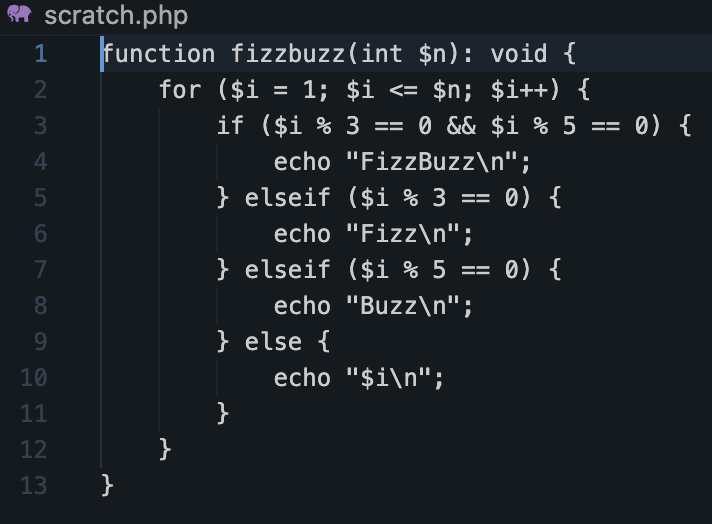

# Lab 0 submission

## Copilot suggestion screenshot

## What the app does

This is LinkKeeper, a small Laravel 13 bookmark manager that serves as the starter app for an AI-augmented development course (Modules 0–3). Each bookmark has a title, a URL, an optional visited_at date and a pinned flag. You can list bookmarks at /bookmarks, add one, and pin or unpin it; /health returns a JSON status, and there's no JavaScript build. For Module 3 you build a tag-merge feature: a TagNormalizer service that collapses near-duplicate tags such as laravel/Laravel, specified case by case in a spec with tests written first. A separate grading/ suite scores your work in CI.

Key files (all under linkkeeper/):

- routes/web.php and app/Http/Controllers/BookmarkController.php: the routes and the bookmark actions
- app/Models/Bookmark.php and app/Models/Tag.php: the data models, with their migrations in database/migrations/
- app/Services/TagNormalizer.php, docs/merge-cases.md (the spec) and tests/Unit/TagNormalizerTest.php: the tag-merge exercise
- database/seeders/TagSeeder.php: the deliberately messy tags the exercise works on
- grading/: the course's grading suite (weights.json, score.py); its README says editing these files only changes the score your own repo reports

## Oddity found

The visited_at docblock is wrong
